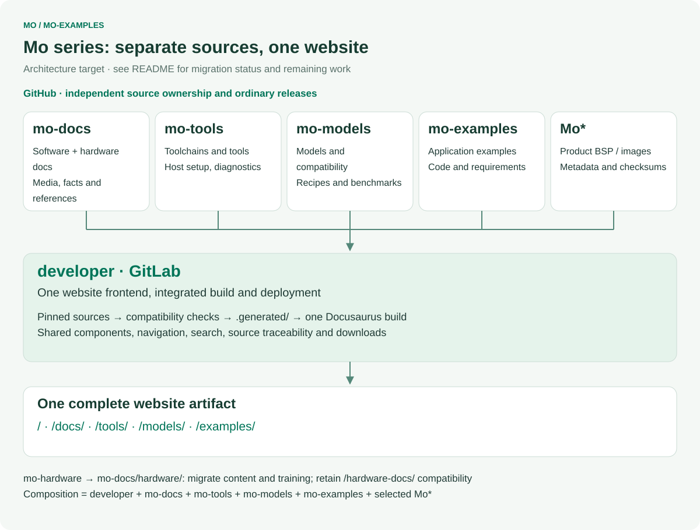
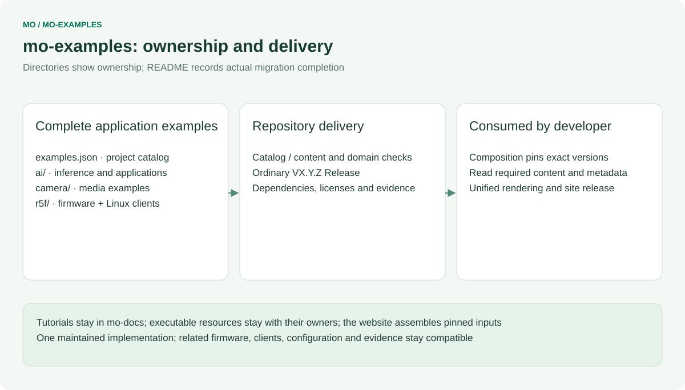
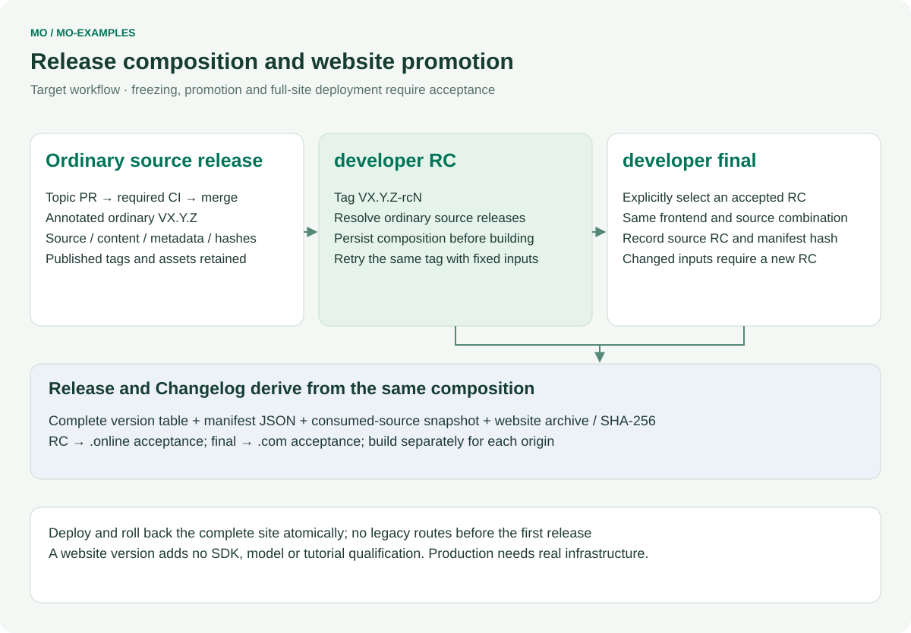

# mo-examples

English | [简体中文](README.zh-CN.md)

Application demos and sample projects for InHand Mo series single-board computers.

This repository will hold runnable demos and sample projects for Mo boards: edge AI applications, camera pipelines, peripheral access, networking, R5F real-time core firmware and ROS 2 integration.

Related repositories:

- [Mo62A](https://github.com/inhandnet/Mo62A) — board support package, OS image build and device-side runtime for the Mo 62A board.
- [mo-docs](https://github.com/inhandnet/mo-docs) — product documentation for the Mo series.

## Mo series repository architecture

[](architecture/repository-map.en.svg)

| Repository | Maintained source | Delivery responsibility |
|---|---|---|
| **developer** · GitLab | Website components, routes, search, integration and contracts | The complete website, release composition and deployment |
| [mo-docs](https://github.com/inhandnet/mo-docs) | Software/hardware tutorials, specifications, media, design files and training | Versioned content and reference assets |
| [mo-tools](https://github.com/inhandnet/mo-tools) | Toolchain/SDK selection, environment setup, reusable tools and Studio | Tool metadata and source packages |
| [mo-models](https://github.com/inhandnet/mo-models) | Model catalog, compilation resources, compatibility and raw benchmarks | Model references, evidence and artifact status |
| [mo-examples](https://github.com/inhandnet/mo-examples) | Complete examples with related firmware, clients and configuration | Example sources and their requirements |
| **Mo\*** · product repositories | Each product's BSP, drivers, root filesystem, image build and flashing | Product images and checksummed release metadata |

`Mo*` covers independently maintained product repositories such as [Mo62A](https://github.com/inhandnet/Mo62A), Mo68A, Mo69A, Mo67A, Mo3588 and Mo3568. The framework does not fix their number. Hardware content and maintainer training move from mo-hardware into mo-docs; mo-hardware remains a historical migration source and is not a separate member of the target website composition.

Each source repository publishes ordinary versions. Developer alone has website RC/final channels. The target composition binds **developer + mo-docs + mo-tools + mo-models + mo-examples + selected Mo\*** to exact commits and consumed-asset hashes. A new source release does not change an already frozen website combination. Tutorial applicability, PCB revisions, image versions and actual validation remain distinct.

## Repository ownership

[](architecture/ownership.en.svg)

## Status

The directory layout, contribution rules and the CI and release pipelines are in place. `ai/` and `camera/` hold the first batch of examples imported from the Mo62A repository and the mo-docs tutorial packages; `peripherals/`, `network/`, `r5f/` and `ros2/` are still placeholders whose `README.md` describes what will be published there. Importing an example into this repository did not re-build or re-run it; each directory README states what was verified and on which image. Catalog publication does not establish new hardware verification or model hosting.

## Repository layout

| Path | Purpose |
| --- | --- |
| `ai/` | Edge AI examples: C/C++ SDK examples (`edgeai-cpp/`), a Python ONNX Runtime smoke test (`python-smoke/`) and the zone-occupancy tutorial application (`zone-demo/`). |
| `camera/` | Camera examples: IMX219 CSI live preview (`imx219-preview/`). |
| `peripherals/` | Peripheral examples. |
| `network/` | Networking examples. |
| `r5f/` | R5F examples (placeholder, P2). |
| `ros2/` | ROS 2 examples (placeholder, P2). |
| `scripts/` | Repository maintenance scripts (commit message check, changelog generation). |
| `.githooks/` | Git hooks that run the commit message check locally. |
| `.github/` | Issue forms, pull request template and GitHub Actions workflows. |
| `release-notes/` | Changelog baseline used by the release workflow. |

## Contributing

Contributions are welcome through pull requests to `master`. Read [CONTRIBUTING.md](CONTRIBUTING.md) for the commit message convention, the pull request process and how to enable the local Git hooks:

```bash
git config core.hooksPath .githooks
```

Every pull request must pass the `commit-message` and `ci` checks before it can be merged. Use GitHub issues for bugs, reproducible problems and feature requests in this repository.

## Releases and tags

[](architecture/release-flow.en.svg)

New releases use annotated ordinary `V<major>.<minor>.<patch>` tags on checked `master` commits. Only developer publishes website release candidates. The release workflow validates catalogs, packages source with SPDX SBOM, records the source commit and catalog hashes in `release.json`, writes SHA-256 checksums, then publishes a complete GitHub Release. Historical RCs remain unchanged. Changelog headings are bilingual; entries retain their English commit summaries.

```bash
git switch master
git pull --ff-only
git tag -a V1.0.0 -m "V1.0.0"
git push origin V1.0.0
```

## Security

Do not report security vulnerabilities in public issues. Follow [SECURITY.md](SECURITY.md).

## License

This repository is licensed under the terms in [LICENSE](LICENSE). Third-party content added later keeps its own license, stated next to the content.

## Unified website integration

`examples.json` lists actual source projects, entrypoints, image/model requirements and tutorial routes. Empty scaffold folders are excluded. `source-available` is not a new board-test claim. Developer reads a pinned source revision, validates the combined data, and renders the website; this repository has no documentation-site frontend or website deployment.

Run `node scripts/check-catalog.mjs` and `node --test tests/*.test.mjs` with Node 22. `validation/` is exported from a committed developer contract and checked by hash; do not edit it locally. For integrated preview, run developer's `npm run preview -- --source mo-examples=/path/to/mo-examples`.

Diagrams are generated centrally by developer/scripts/render-architecture.mjs. Regenerate all repository diagrams after changing the common architecture. Diagrams show ownership; the status section and catalog define currently available content and verification.

R5F firmware, client and test resources currently remain in mo-docs. Their target owner is this repository; projects are added to examples.json only after their sources are integrated.

Regenerate these diagrams from developer with `node scripts/render-architecture.mjs --repo mo-examples --out /path/to/mo-examples/architecture`. Catalog and documentation changes remain in the topic PR; resource consolidation, release freezing and full-site rollout have separate acceptance. Open each diagram to read the original SVG.
