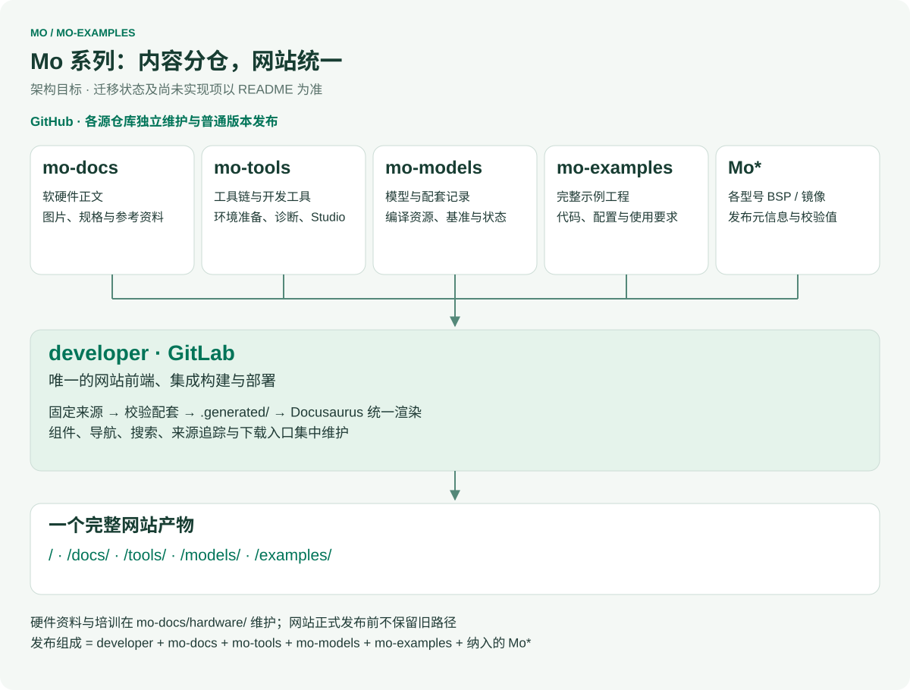
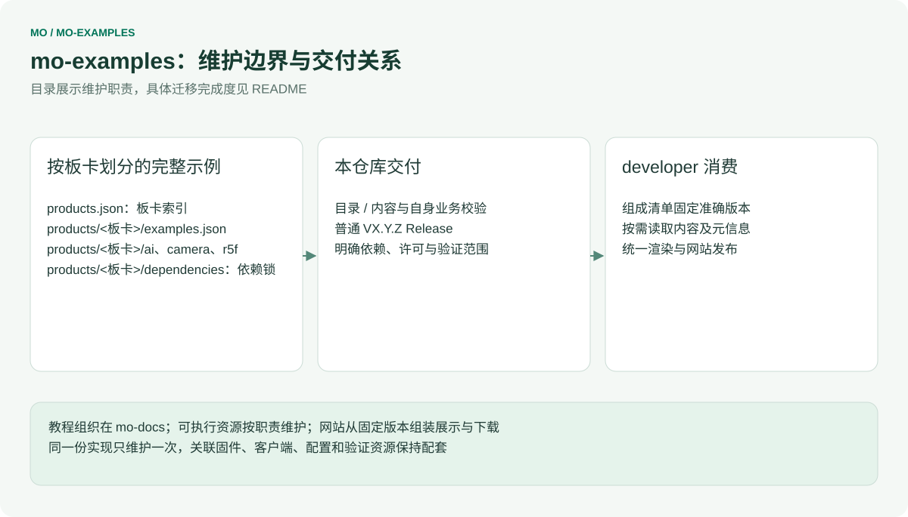
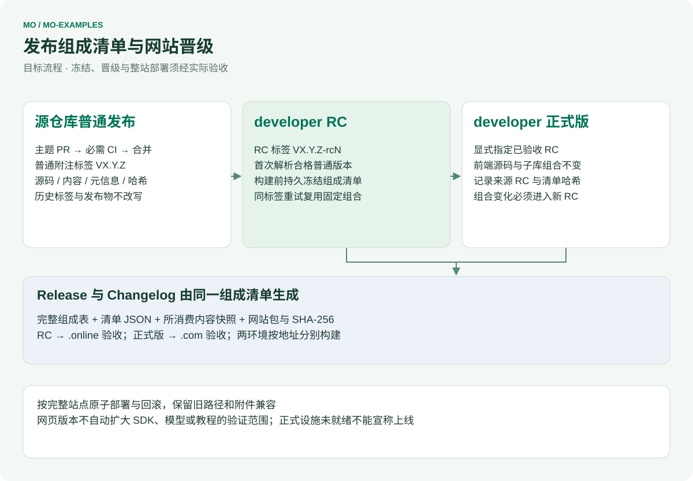

# mo-examples

[English](README.md) | 简体中文

InHand Mo 系列单板计算机的应用演示与示例项目。

相关仓库：[Mo62A](https://github.com/inhandnet/Mo62A)（Mo 62A 板级支持与系统镜像）、[mo-docs](https://github.com/inhandnet/mo-docs)（产品文档）。

## Mo 系列仓库协同架构

<table width="100%">
  <thead>
    <tr>
      <th width="171" align="left">仓库</th>
      <th width="398" align="left">人工维护的源内容</th>
      <th width="379" align="left">交付职责</th>
    </tr>
  </thead>
  <tbody>
    <tr>
      <td align="left"><strong>developer</strong> · GitLab</td>
      <td align="left">网站组件、路由、搜索、接入层与内容接口</td>
      <td align="left">完整网站、发布组成清单与部署</td>
    </tr>
    <tr>
      <td align="left"><a href="https://github.com/inhandnet/mo-docs">mo-docs</a></td>
      <td align="left">软硬件教程、规格、媒体、设计资料与维护培训</td>
      <td align="left">版本化内容与参考附件</td>
    </tr>
    <tr>
      <td align="left"><a href="https://github.com/inhandnet/mo-tools">mo-tools</a></td>
      <td align="left">工具链/SDK 选择、环境准备、通用开发工具与 Studio</td>
      <td align="left">工具元信息和源码包</td>
    </tr>
    <tr>
      <td align="left"><a href="https://github.com/inhandnet/mo-models">mo-models</a></td>
      <td align="left">模型目录、编译资源、兼容关系与原始基准</td>
      <td align="left">模型引用、验证证据与托管状态</td>
    </tr>
    <tr>
      <td align="left"><a href="https://github.com/inhandnet/mo-examples">mo-examples</a></td>
      <td align="left">完整示例及配套固件、客户端和配置</td>
      <td align="left">示例源码及适用条件</td>
    </tr>
    <tr>
      <td align="left"><strong>Mo*</strong> · 各型号仓库</td>
      <td align="left">各自 BSP、驱动、根文件系统、镜像构建与烧录</td>
      <td align="left">系统镜像及带校验值的发布元信息</td>
    </tr>
  </tbody>
</table>

`Mo*` 表示各型号独立的产品仓库，例如 [Mo62A](https://github.com/inhandnet/Mo62A)、Mo68A、Mo69A、Mo67A、Mo3588、Mo3568，框架不固定数量。mo-hardware 的资料与维护培训迁入 mo-docs；mo-hardware 保留为历史迁移来源，不再单列为目标网站发布组成项。

各源仓库独立发布普通版本，只有 developer 区分网站 RC 与正式版。目标发布组成绑定 **developer + mo-docs + mo-tools + mo-models + mo-examples + 纳入的 Mo\***，记录准确提交与所消费附件哈希。上游新发版本不会改变已冻结的网站组合。教程适用范围、PCB 修订、镜像版本和实际验证结论分别记录。

## 本仓库维护边界

## 状态

目录结构、贡献规范以及 CI 与发布流水线已就绪。`ai/` 与 `camera/` 已加入第一批示例（来自 Mo62A 仓库与 mo-docs 教程包）；`network/ble/`、`r5f/mcu-console/`、`camera/jpeg-capture/` 和 `ai/npu-demo/` 已接收教程配套资源；`peripherals/` 与 `ros2/` 仍为占位目录，其 `README.md` 说明将要存放的内容。示例迁入本仓库时未重新编译或重新运行，各目录 README 写明了验证范围与对应镜像版本。目录发布不增加实机验证结论。

## 目录结构

- `ai/` — Edge AI 示例：C/C++ SDK 示例（`edgeai-cpp/`）、Python ONNX Runtime 冒烟测试（`python-smoke/`）、区域占用教程应用（`zone-demo/`）
- `camera/` — 摄像头示例：IMX219 CSI 实时预览（`imx219-preview/`）
- `peripherals/` — Peripheral examples
- `network/` — BLE 外设与 GATT 检查
- `r5f/` — MCU 控制台固件、主机客户端、RPMsg 与重载检查
- `ros2/` — ROS 2 示例（占位）
- `scripts/` — 仓库维护脚本（提交信息检查、变更记录生成）
- `.githooks/` — 本地提交信息检查钩子
- `.github/` — Issue 表单、PR 模板与 GitHub Actions 工作流

## 参与贡献

通过 PR 提交到 `master`。提交信息规范、PR 流程与本地钩子启用方法见 [CONTRIBUTING.md](CONTRIBUTING.md)（`git config core.hooksPath .githooks`）。PR 必须通过 `commit-message` 与 `ci` 两项检查后才能合并。使用本仓库的 GitHub Issues 提交可复现问题和功能建议。

## 发布与标签

新发布仅使用已通过检查的 master 提交上的普通附注标签 `VX.Y.Z`；只有 developer 发布网站 RC。工作流校验目录数据、生成源码包和 SPDX SBOM，在 release.json 中记录源码提交与目录哈希，计算 SHA-256，全部附件就绪后公开 Release。历史 RC 保留不变。Changelog 中英文标题固定，条目保留英文。

## 安全

请勿在公开 Issue 中报告安全漏洞，见 [SECURITY.md](SECURITY.md)。

## 许可证

见 [LICENSE](LICENSE)。

## 统一网站接入

examples.json 只列出已有源码工程、入口、镜像/模型依赖和教程路由，空占位目录不算示例；源码可用不代表新一轮实机验收通过。 developer 固定源码版本后统一校验和渲染，本仓库不部署文档网站。

Node 22 下运行 `node scripts/check-catalog.mjs` 和 `node --test tests/*.test.mjs`。validation/ 是 developer 已提交规则的固定副本，通过哈希核验，不手工编辑。集成预览在 developer 中运行 `npm run preview -- --source mo-examples=/path/to/mo-examples`。

框架图由 developer/scripts/render-architecture.mjs 统一生成，修改公共架构后同步生成各仓库图。图中为职责边界；当前可用目录和验证范围以状态段及目录清单为准。

R5F 固件、客户端和检查资源已成组迁入 [r5f/mcu-console](r5f/mcu-console/README.md)。`examples.json` 共列出 8 项现有示例；R5F 项记录 SDK、编译器和 SysConfig 的版本与哈希，developer 校验所选 mo-tools 配套。

生成本仓库图示：在 developer 中运行 `node scripts/render-architecture.mjs --repo mo-examples --out /path/to/mo-examples/architecture`。本轮目录与文档仍在主题 PR 中；资源归属整理、网站发布冻结及整站上线按迁移状态分别验收。点击图示可查看原始 SVG。

## 模型接口与完整下载包

zone-demo 的 `model.py` 是 mo-models 的生成副本，来源记录于 `dependencies/model-contract.json`。更新时运行 `node scripts/sync-model-contract.mjs /path/to/mo-models`，只接受已提交的权威源；CI 与网站集成均核对哈希。示例源码可以独立使用；包含模型编译和主机准备脚本的完整教程包由 developer 组装，附每个文件的来源与哈希。
